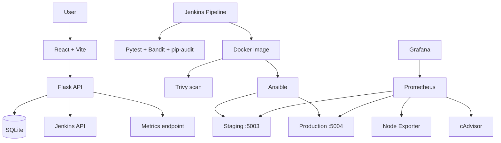

# SecureFlow — DevOps Automation & Infrastructure Monitoring Platform

SecureFlow combines a React dashboard, Flask API, Docker packaging, Jenkins CI, Ansible deployment playbooks, and Prometheus/Grafana monitoring.

## What is SecureFlow?

SecureFlow is a DevOps Automation and Infrastructure Monitoring Platform that integrates application testing, security scanning, deployment automation, and infrastructure monitoring into one workflow.

It combines a React dashboard and Flask REST API with Jenkins for CI/CD, Docker for containerization, Ansible for deployment automation, and Prometheus and Grafana for monitoring.

## Why is SecureFlow needed?

Software deployment involves repetitive tasks such as testing code, checking vulnerabilities, building application images, deploying services, and monitoring application health.

Performing these tasks manually can lead to human errors, inconsistent deployments, delayed issue detection, and security risks.

SecureFlow addresses these challenges by automating the workflow and providing centralized visibility into application and infrastructure health.

## When is SecureFlow used?

- **During development:** To run automated tests when application code changes.
- **During continuous integration:** To build applications and perform security scans.
- **During deployment:** To deploy containerized applications to staging and production environments.
- **During monitoring:** To track application health, service availability, and infrastructure metrics.
- **During troubleshooting:** To investigate failed builds, deployment issues, and service failures.

## Benefits of SecureFlow

- **Automation:** Reduces repetitive manual tasks.
- **Faster delivery:** Streamlines the build, test, and deployment workflow.
- **Improved security:** Integrates automated code and container vulnerability scanning.
- **Consistent deployments:** Uses Docker and Ansible for repeatable deployment processes.
- **Centralized monitoring:** Provides infrastructure and application visibility through Prometheus and Grafana.
- **Reliability:** Separates staging and production environments and supports rollback procedures.
## Features
- React dashboard backed by a Flask REST API.
- SQLite persistence for deployment records.
- Jenkins build information integration through the backend API.
- Jenkins pipeline for tests, Bandit, pip-audit, Docker build, and Trivy image scanning.
- Ansible playbooks for staging, production, and production rollback.
- Prometheus metrics collection and Grafana dashboard provisioning.

## Architecture



## Technology versions

| Component | Version |
|---|---|
| Python local | 3.13.x 64-bit (verified with 3.13.5) |
| Python Docker base | `python:3.13.18-slim-trixie` |
| Flask | 3.1.3 |
| Flask-SQLAlchemy | 3.1.1 |
| SQLAlchemy | 2.0.44 |
| pytest | 9.0.3 |
| Gunicorn | 23.0.0 |
| prometheus-client | 0.23.1 |
| Node.js | 22.x (verified with 22.20.0) |
| npm | 10.x (verified with 10.9.3) |
| React | 19.2.0 |
| Vite | 7.x (verified build with 7.3.8) |
| Tailwind CSS | 4.1.14 |
| Jenkins | 2.580.2 with JDK 21 |
| Docker CLI in Jenkins image | 29.9.3 |
| Ansible Core | 2.19.2 |
| Docker SDK for Python | 7.1.0 |
| community.docker | 4.7.0 |
| Prometheus | 3.5.0 |
| Grafana | 12.1.1 |
| Node Exporter | 1.9.1 |
| cAdvisor | 0.52.1 |
| Bandit | 1.9.4 |
| pip-audit | 2.10.1 |
| Trivy in pipeline | 0.76.2 |

Frontend dependencies use semver ranges in `package.json`. Use the committed `frontend/package-lock.json` with `npm ci` if present to reproduce the exact dependency tree.

## Repository structure

```text
SecureFlow-Complete/
├── .github/
├── ansible/
│   └── playbooks/             # staging, production, rollback
├── backend/
│   ├── app/
│   │   └── routes/            # health, status, deployments, Jenkins
│   ├── tests/
│   ├── requirements.txt
│   └── run.py
├── docker/                    # application Dockerfile and entrypoint
├── docs/                      # project guides
├── frontend/
│   ├── src/
│   └── package.json
├── jenkins/                   # Jenkins image and plugin list
├── monitoring/
│   ├── grafana/               # dashboard and provisioning
│   └── prometheus/            # scrape config and alert rules
├── security/                  # Bandit, pip-audit and scan script
├── docker-compose.yml         # monitoring services
└── Jenkinsfile
```

## Prerequisites

- Git
- Python 3.13, 64-bit
- Node.js 22.x and npm 10.x
- Docker Desktop with WSL2 on Windows, or Docker Engine and Compose on Linux
- PowerShell for the supplied security scan script
- Jenkins only if reproducing CI/CD

Official downloads: [Python](https://www.python.org/downloads/), [Node.js](https://nodejs.org/en/download), [Git](https://git-scm.com/downloads), [Docker Desktop](https://www.docker.com/products/docker-desktop/).

Verify:

```powershell
git --version
python --version
py -0p
node --version
npm --version
docker --version
docker compose version
```

## Clone and install

```powershell
git clone https://github.com/k-madhumithaa/SecureFlow-Complete.git
cd SecureFlow-Complete

py -3.13 -m venv .venv
.\.venv\Scripts\Activate.ps1
python -m pip install --upgrade pip
python -m pip install -r backend\requirements.txt
python -m pip install -r security\requirements-security.txt
```

Frontend:

```powershell
cd frontend
npm ci
npm run lint
npm run build
cd ..
```

If `package-lock.json` is not included in the repository, use `npm install` once and commit the generated lockfile; subsequent clean installs should use `npm ci`.

## Configuration and secrets

Backend configuration reads:

| Variable | Purpose | Default |
|---|---|---|
| `SECRET_KEY` | Flask secret | Development-only fallback in current code; override outside development |
| `DATABASE_URL` | SQLAlchemy database URI | SQLite database under `backend/instance/secureflow.db` |
| `JENKINS_URL` | Jenkins base URL | `http://127.0.0.1:8080` |
| `JENKINS_USERNAME` | Jenkins API username | Not set |
| `JENKINS_API_TOKEN` | Jenkins API token | Not set |
| `JENKINS_JOB_NAME` | Jenkins job | `SecureFlow-CI-CD` |
| `GRAFANA_ADMIN_PASSWORD` | Grafana admin password | Required by Compose |

Set secrets in the local shell; never commit them:

```powershell
$env:SECRET_KEY = "replace-with-a-long-random-value"
$env:JENKINS_URL = "http://127.0.0.1:8080"
$env:JENKINS_USERNAME = "your-jenkins-username"
$env:JENKINS_JOB_NAME = "SecureFlow-CI-CD"
$secureToken = Read-Host "Jenkins API token" -AsSecureString
$env:JENKINS_API_TOKEN = [System.Net.NetworkCredential]::new("", $secureToken).Password
```

For Compose, set `GRAFANA_ADMIN_PASSWORD` in the shell or a local Git-ignored `.env` file:

```powershell
$secureGrafanaPassword = Read-Host "Grafana admin password" -AsSecureString
$env:GRAFANA_ADMIN_PASSWORD = [System.Net.NetworkCredential]::new("", $secureGrafanaPassword).Password
```

## Run locally

Terminal 1, from repository root:

```powershell
.\.venv\Scripts\Activate.ps1
$env:PYTHONPATH = "$PWD\backend"
python backend\run.py
```

Terminal 2:

```powershell
cd frontend
npm run dev
```

Open `http://127.0.0.1:5173`. The Vite config proxies `/backend` to `http://127.0.0.1:5000` and `/prometheus` to `http://127.0.0.1:9090`.

## Run backend in Docker

```powershell
docker build -f docker/Dockerfile -t secureflow:local .
docker run -d --name secureflow-local -p 5000:5000 `
  -v secureflow-local-data:/app/backend/instance secureflow:local

Invoke-RestMethod http://127.0.0.1:5000/health
Invoke-RestMethod http://127.0.0.1:5000/ready
```

The Docker image uses a multi-stage build and runs as non-root `appuser` (UID 10001).

## Monitoring

The root `docker-compose.yml` starts monitoring services only; it does not start the app or Jenkins.

```powershell
docker compose config
docker compose up -d
docker compose ps
```

| Service | URL |
|---|---|
| Prometheus | http://127.0.0.1:9090 |
| Grafana | http://127.0.0.1:3000 |

Grafana username is `admin`; password is the value supplied through `GRAFANA_ADMIN_PASSWORD`. Prometheus scrapes itself, staging (`host.docker.internal:5003`), production (`host.docker.internal:5004`), Node Exporter, and cAdvisor. Scrape/evaluation interval is 15 seconds.

Alerts: API down for 1 minute; 5xx rate above 5% for 2 minutes; p95 latency above 1 second for 2 minutes. Dashboard and provisioning files are in `monitoring/grafana/`.

Stop containers but preserve data:

```powershell
docker compose down
```

Avoid `docker compose down -v` unless you intend to delete monitoring volumes.

## Jenkins CI pipeline

The root `Jenkinsfile` performs checkout, backend tests, Bandit, pip-audit, Docker image build, Trivy HIGH/CRITICAL scan, JUnit publication, and JSON report archiving.

`jenkins/Dockerfile` uses Jenkins `2.580.2-jdk21` and Docker CLI `29.9.3`; plugins are listed in `jenkins/plugins.txt`.

To reproduce CI, create a Jenkins Pipeline job named `SecureFlow-CI-CD` configured to load this repository's `Jenkinsfile` from SCM. The Jenkins execution environment needs Docker CLI and permission to access the Docker daemon. Docker socket access is highly privileged; grant it only to trusted Jenkins workloads.

## Ansible deployment

Build the application image and Ansible runner from the repository root:

```powershell
docker build -f docker/Dockerfile -t secureflow:1.1.3 .
docker build -f ansible/Dockerfile -t secureflow-ansible:1.0 ./ansible
```

The playbook defaults in this repository are:
- Staging: `secureflow:1.1.3`, container `secureflow-staging`, port `5003`, volume `secureflow-staging-data`.
- Production: `secureflow:1.1.2`, container `secureflow-production`, port `5004`, volume `secureflow-production-data`.
- Rollback: `secureflow:1.0.7`.

These are current committed playbook values. A fresh clone does not contain these Docker images automatically. Build or load the exact tag before executing a playbook, and deliberately update playbook tags when promoting an image.

Staging requires Jenkins variables in the Ansible runner environment:

```powershell
docker run --rm --workdir /workspace/ansible `
  --mount "type=bind,source=$($PWD.Path),target=/workspace" `
  --mount "type=bind,source=/var/run/docker.sock,target=/var/run/docker.sock" `
  --env JENKINS_URL --env JENKINS_USERNAME --env JENKINS_API_TOKEN --env JENKINS_JOB_NAME `
  secureflow-ansible:1.0 `
  ansible-playbook -i inventory.ini playbooks/deploy-staging.yml
```

After staging deploy, verify:

```powershell
Invoke-RestMethod http://127.0.0.1:5003/health
Invoke-RestMethod http://127.0.0.1:5003/ready
```

Production deploy and rollback are operational actions. Review their image tags, environment, backups, and database compatibility before running. The production playbook does not currently pass Jenkins environment variables.

## Tests and security

Backend:

```powershell
$env:PYTHONPATH = "$PWD\backend"
python -m pytest backend\tests -v
```

Frontend:

```powershell
cd frontend
npm run lint
npm run build
cd ..
```

Security:

```powershell
.\security\run_security_scan.ps1
```

The script writes Bandit and pip-audit JSON reports under `security/reports/`. Jenkins additionally scans the built image with Trivy. A clean scan is a point-in-time result, not a guarantee of security.

## API routes

| Method | Path | Purpose |
|---|---|---|
| GET | `/health` | Health check |
| GET | `/ready` | Readiness check |
| GET | `/api/status` | Application status |
| GET | `/api/deployments` | List deployment records |
| POST | `/api/deployments` | Create deployment record |
| GET | `/api/jenkins/builds` | Jenkins job/build information |
| GET | `/metrics` | Prometheus metrics |

See `backend/app/routes/` and `backend/tests/` for route behavior and request/response details.

## Troubleshooting

- Compose reports missing `GRAFANA_ADMIN_PASSWORD`: set it in the shell or local `.env`.
- Frontend API calls fail: confirm Flask is listening on port 5000, as configured in `frontend/vite.config.js`.
- Prometheus target is DOWN: verify the corresponding app container/port and Prometheus target configuration.
- Jenkins endpoint fails: verify Jenkins URL, username, token, job name, and network access; do not print token values.
- Ansible cannot access Docker: check Docker Desktop and socket mounting.
- Image not found during deploy: build/load the exact tag named in the selected playbook.
- Port conflict: identify the process using the port before changing or stopping anything.

## Security and limitations

- `.gitignore` excludes `.env`, databases, virtual environments, Node modules, build output, and generated security reports.
- Do not commit API tokens, passwords, keys, or local database files.
- The current Flask config has a development-only fallback secret; override it for non-development use.
- cAdvisor is configured privileged with host paths mounted read-only. Review before use on shared hosts.
- Docker socket access for Jenkins/Ansible is effectively host-level access.
- On Docker Desktop, cAdvisor may expose fewer container labels/metrics than on native Linux.
- The frontend build has previously succeeded with a non-blocking large-chunk warning.

## License

No license file was present in the reviewed repository. Add a `LICENSE` file before declaring reuse terms.
